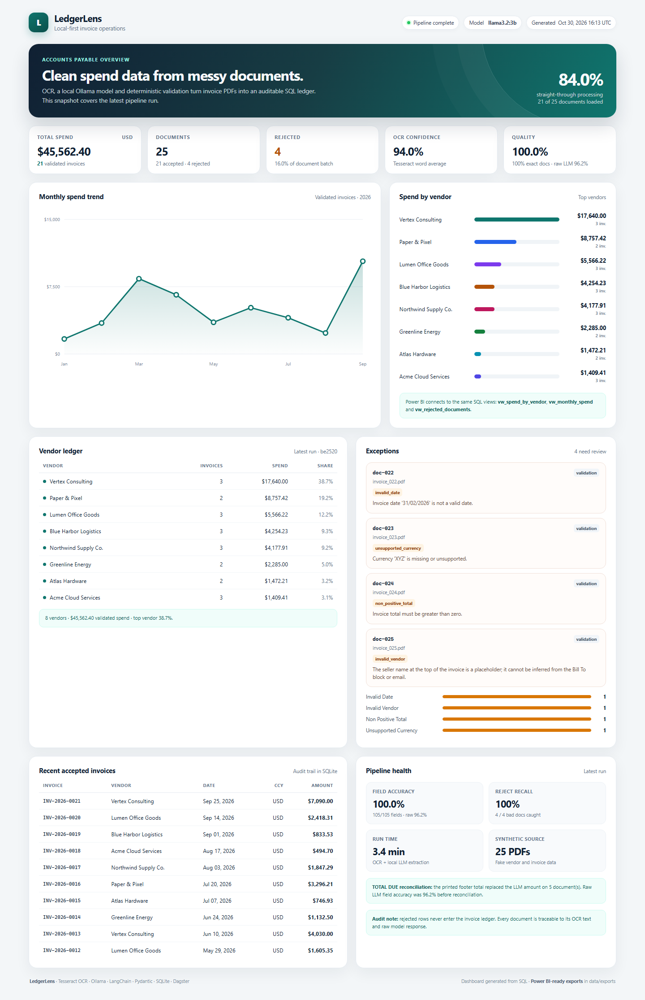

# LedgerLens

**A local-first invoice pipeline built in one day.** It turns PDF invoices into
validated, queryable spend data using Tesseract OCR, a local Ollama model, and
deterministic business rules. The full chain is orchestrated as a Dagster asset
graph, persisted in SQLite, and exposed to Power BI and a self-contained HTML
dashboard.

> All 25 invoices in the repository are synthetic. Vendor names, amounts and
> tax IDs are fake.



## What it does

```
25 synthetic PDFs
      |
      v
Tesseract OCR  ---------> raw text + OCR confidence
      |
      v
LangChain + Ollama (llama3.2:3b, local)
      |
      v
Pydantic field extraction (JSON)
      |
      v
Deterministic validation & normalization
      |                              |
      | accepted                     | rejected
      v                              v
SQLite invoices                SQLite rejected_documents
      |                              |
      +--------------+---------------+
                     |
          +----------+-----------+
          |                      |
          v                      v
   Power BI views          HTML dashboard
```

Dagster asset graph:

```
source_documents -> ocr_text -> extracted_invoices -> validated_invoices
                                                            |
                                               invoice_ledger -> operations_dashboard
```

## Stack

| Layer | Choice |
|---|---|
| PDF rendering | PyMuPDF (replaces `pdf2image`/Poppler on Windows) |
| OCR | Tesseract 5 via `pytesseract` |
| Local LLM | Ollama + `llama3.2:3b` |
| LLM framework | LangChain (`langchain-ollama`) |
| Schema and validation | Pydantic 2 + deterministic rules |
| Orchestration | Dagster asset graph |
| Storage | SQLite (integer cents, SQL views) |
| Analytics | SQL + pandas |
| BI | Power BI connection kit + HTML fallback dashboard |
| Tests | pytest |

## Results

<!-- RESULTS:START -->
Measured on 30 October 2026 with Tesseract 5.4, `llama3.2:3b`, 300 DPI, and the
25-document batch (21 valid, 4 intentionally bad).

| Metric | Result |
|---|---|
| Documents accepted / rejected | **21 / 4** |
| Straight-through processing | **84.0%** |
| Total validated spend | **$45,562.40** |
| Final field accuracy (105 fields) | **100.0% (105/105)** |
| Final exact-document match | **100.0% (21/21)** |
| Raw LLM field accuracy | **96.2% (101/105)** |
| Raw LLM exact-document match | **81.0% (17/21)** |
| Rejected documents caught | **4/4 (100%)** |
| Expected rejection reasons matched | **4/4 (100%)** |
| OCR mean word confidence | **94.0%** |
| Cold OCR time | **58.3 s** |
| Cold local-LLM time | **145.1 s** |
| Cached full Dagster run | **8.9 s** |

On the 21 valid invoices, the raw model got all invoice numbers, dates, vendors
and currencies right, but returned the wrong total on 4 (documents 009, 011,
017 and 019). It sometimes returned the subtotal and sometimes a hallucinated
number. The printed-`TOTAL DUE` reconciliation corrected all four; it also
corrected doc-025, which is rejected for its placeholder seller. Raw values are
preserved in `data/extracted/*.json` under `model_extraction`.

Largest vendor: **Vertex Consulting** at **$17,640.00** across 3 invoices.
Highest month: **September 2026** at **$10,341.84**. Full vendor and monthly
breakdowns come from the SQL views and are shown on the dashboard.
<!-- RESULTS:END -->

## Quick start (Windows)

Prerequisites: Windows 10/11, Python 3.11+, ~8 GB free disk, internet access
for the initial install. A GPU is optional; the 3B model also runs on CPU.

```powershell
cd ledgerlens
.\scripts\setup.ps1          # Tesseract, Ollama, venv, Python deps, model
.\scripts\run.ps1            # one-command full pipeline
```

Or, after setup:

```powershell
.venv\Scripts\ledgerlens.exe doctor
.venv\Scripts\ledgerlens.exe run
.venv\Scripts\ledgerlens.exe serve
```

`ledgerlens run` materializes every Dagster asset. Cached OCR and extraction
results are reused, so subsequent runs are fast. Use `--full-refresh` to rebuild
everything, or `--limit 5` for a smoke test.

### Manual setup

```powershell
# 1. Tesseract: https://github.com/UB-Mannheim/tesseract/wiki
# 2. Ollama: https://ollama.com/download
ollama serve
ollama pull llama3.2:3b

# 3. Python environment
python -m venv .venv
.venv\Scripts\python.exe -m pip install -e ".[dev]"

# 4. Verify and run
.venv\Scripts\ledgerlens.exe doctor
.venv\Scripts\ledgerlens.exe run
```

On macOS/Linux, install Tesseract with your package manager, use
`source .venv/bin/activate`, and substitute `.venv/bin/ledgerlens` for the
Windows executable. The code is otherwise cross-platform.

## Commands

| Command | Purpose |
|---|---|
| `ledgerlens run` | Full Dagster pipeline (one command) |
| `ledgerlens doctor` | Check Tesseract, Ollama, model and artifacts |
| `ledgerlens generate --force` | Rebuild the 25 synthetic PDFs + ground truth |
| `ledgerlens ocr [--force] [--limit N]` | OCR only |
| `ledgerlens extract [--force]` | Local-LLM extraction only |
| `ledgerlens validate` | Normalize and validate, write rejection report |
| `ledgerlens ingest` | SQLite load, evaluation, dashboard |
| `ledgerlens query all` | Print KPI, vendor, monthly and rejection queries |
| `ledgerlens history` | List previous runs |
| `ledgerlens dashboard` | Rebuild HTML + CSV exports |
| `ledgerlens serve --port 8765` | Serve the dashboard locally |
| `ledgerlens --model qwen2.5:3b run` | Use another local model |
| `dagster dev -m ledgerlens.orchestration` | Open the Dagster asset UI |

## Pipeline details

### 1. Document generation (`generate_samples.py`)

25 single-page PDFs are generated with ReportLab. The batch deliberately covers
normal and exceptional cases:

- 21 valid invoices across nine months and eight vendors
- date formats: ISO, `March 13, 2026`, `13 Mar 2026`, `27/03/2026`
- vendor-name variants that require normalization (`ACME CLOUD SERVICES`,
  `PAPER AND PIXEL`, legal suffixes)
- four rejected invoices: impossible date (`31/02/2026`), unsupported currency
  (`XYZ`), negative total, and placeholder vendor (`N/A`)

`data/ground_truth.csv` contains the expected values used for evaluation.

### 2. OCR (`ocr.py`)

Each PDF page is rasterized at 300 DPI with PyMuPDF and sent to Tesseract
(`--oem 3 --psm 3`). The raw text is stored in `data/ocr_text/<doc>.txt`; OCR
metadata, including mean word confidence, is stored alongside in JSON. Cached
text is invalidated when the DPI or source file changes.

### 3. Extraction (`extract.py`)

LangChain's `ChatOllama` calls the local model with `format="json"`, temperature
0, and a strict system prompt. The five fields are represented by a Pydantic
model (`RawInvoice`). The prompt explicitly forbids guessing, repairing, or
using the "Bill to" customer as the vendor. Invalid JSON triggers one repair
attempt. Extractions are cached in `data/extracted/` together with the raw model
response and prompt version.

After parsing, the total is reconciled against the printed `TOTAL DUE` label in
the OCR text. A 3B model occasionally invents or mis-adds a total even when the
correct amount is visible; the printed footer total is authoritative. The raw
model value is retained in `model_extraction` for evaluation, and every repair
is listed in `reconciliations`.

### 4. Validation (`normalization.py`)

The LLM is never trusted with final values. Pydantic checks types; deterministic
rules then:

- normalize invoice numbers (`INV 2026 0001` -> `INV-2026-0001`)
- parse multiple human date formats into an ISO date
- parse totals to integer cents (no floating-point money)
- normalize currency symbols/codes to ISO 4217 and reject unsupported ones
- normalize vendor aliases and reject placeholders
- reject a document whose printed seller header is explicitly `N/A`, even if
  the model inferred a name from the Bill To block or email domain
- reject missing required fields, invalid dates, non-positive totals
- detect duplicate invoice numbers within a run

Every failure is written to `data/validation/validation_report.json` and later
to the `rejected_documents` and `rejection_reasons` tables. Rejected rows never
enter the invoice table.

### 5. SQL (`sql/schema.sql`)

The database has three core tables (`ingestion_runs`, `invoices`,
`rejected_documents`) plus normalized rejection reasons. Money is stored as
`total_cents`, and each run is immutable. The latest run is exposed through
views so both Power BI and the HTML dashboard read a stable snapshot.

Four analytical queries live in `sql/`:

- `spend_by_vendor.sql`
- `monthly_totals.sql`
- `rejected_documents.sql`
- `run_summary.sql`

```powershell
.venv\Scripts\ledgerlens.exe query vendors
.venv\Scripts\ledgerlens.exe query monthly
.venv\Scripts\ledgerlens.exe query rejected
```

### 6. Orchestration (`orchestration.py`)

The stages are Dagster assets with explicit dependencies. `ledgerlens run`
materializes the graph in-process and fails the command if any asset fails.
`dagster dev -m ledgerlens.orchestration` provides the asset graph UI, run
history and logs.

### 7. Dashboard and Power BI

- Static demo: `data/dashboard.html` (self-contained, no CDN or server needed).
- Power BI kit: `powerbi/` contains connection instructions, DAX measures and a
  theme. The SQL views are the intended semantic layer.
- CSV exports: `data/exports/` is a driver-free path for Power BI Desktop.

See [powerbi/README.md](powerbi/README.md) for the ODBC, CSV and Python options.

The Power BI Desktop report built against these views is still being finalised and
is intentionally not committed yet (`*.pbix` is git-ignored). The HTML dashboard is
the version of record in this repository.

## Evaluation

Run `ledgerlens run`, then inspect:

- `data/reports/evaluation.json` - field accuracy, exact-match documents,
  rejection catch rate, OCR confidence, timings
- `data/reports/run_summary.json` - all dashboard data
- `data/ground_truth.csv` - labels
- `data/extracted/*.json` - raw LLM output and cache metadata
- `data/validation/validation_report.json` - accepted/rejected with reasons

Metrics are computed only against the 21 documents expected to pass, using the
same normalization as the validator. Two extraction numbers are reported:
**raw LLM** accuracy before the printed-`TOTAL DUE` reconciliation, and **final**
accuracy after it. The rejection catch rate checks whether all four bad
documents were stopped and whether the expected reason code was identified.

## Repository layout

```
ledgerlens/
  src/ledgerlens/
    config.py            # environment + paths
    models.py            # Pydantic contracts
    generate_samples.py  # synthetic invoice generator
    ocr.py               # PDF -> image -> Tesseract
    extract.py           # LangChain + Ollama, caching
    normalization.py     # field parsing + business rules
    validation.py        # batch validation + duplicate detection
    storage.py           # SQLite load, views, queries
    evaluation.py        # accuracy against ground truth
    dashboard.py         # HTML dashboard + CSV exports
    orchestration.py     # Dagster assets and job
    cli.py               # one-command interface
  sql/                   # schema + four analytical queries
  powerbi/               # DAX, theme, connection guide
  scripts/               # setup.ps1, run.ps1
  tests/                 # unit tests
  data/                  # generated artefacts (git-ignored)
  docs/                  # dashboard screenshot
```

## Problems hit and decisions

- **Windows + OCR dependencies.** `pdf2image` requires Poppler, which is an
  extra binary install on Windows. PyMuPDF renders pages equally well without
  it. Tesseract itself remains the OCR engine.
- **Structured output from a 3B model.** Even with JSON mode, small models can
  invent a missing value. The pipeline treats model output as untrusted,
  includes strict null rules, retries once on malformed JSON, and makes
  validation authoritative. On this batch the raw model got four totals wrong
  (it sometimes returned the subtotal or a hallucinated number). A deterministic
  reconciliation step now anchors the total to the printed `TOTAL DUE` amount;
  the raw result is kept for honest accuracy reporting.
- **Vendor inference from context.** The model initially chose the "Bill to"
  customer as the vendor on two Paper & Pixel invoices; a stricter prompt fixed
  that. One deliberately bad invoice prints `N/A` as the seller, and the model
  tried to infer Northwind from the email domain. Validation now rejects a
  placeholder seller header instead of trusting that inference.
- **OCR reading order.** Tesseract returns the header and totals in a
  non-linear order on these layouts. The prompt uses printed labels (INVOICE
  NO., DATE, TOTAL DUE) rather than line position, and the footer amount is used
  as a deterministic cross-check.
- **Money precision.** All amounts are converted to integer cents before SQL;
  no floating-point arithmetic is used for totals.
- **Date ambiguity.** The sample generator avoids ambiguous `03/04/2026` dates;
  the parser handles the unambiguous formats it emits and rejects impossible
  calendar dates.
- **Power BI is not headless.** Power BI Desktop is a GUI-only Windows app and
  a `.pbix` is a binary. This repository ships the SQL views, DAX measures, a
  theme and an HTML preview instead of pretending to generate a signed-in
  interactive report. The connection steps are documented.
- **SQLite and Power BI.** Power BI has no native SQLite connector, so the
  recommended route is the 64-bit SQLite ODBC driver; CSV and Python options
  are included as fallbacks.
- **Hardware.** The test machine has an RTX 4060 (8 GB) and 32 GB RAM. A 3B
  model leaves headroom and keeps extraction local.

## Limitations / next steps

- The documents are synthetic and all valid invoices use USD. Add scans, skew,
  multi-page invoices and real FX conversion for production.
- Add a human review queue for rejected documents instead of only logging them.
- Add a `documents` hash table for idempotency across overlapping batches.
- Power BI incremental refresh and row-level security are out of prototype scope.
- The `TOTAL DUE` anchor assumes a conventional invoice footer. Production
  documents with multiple totals, deposits or credits need line-item
  reconciliation rather than a single footer amount.
- The local 3B model is deliberately small; a fine-tuned extraction model would
  improve raw total accuracy, leaving the deterministic checks as a safety net.

## License

MIT. Data is synthetic and safe to share.
